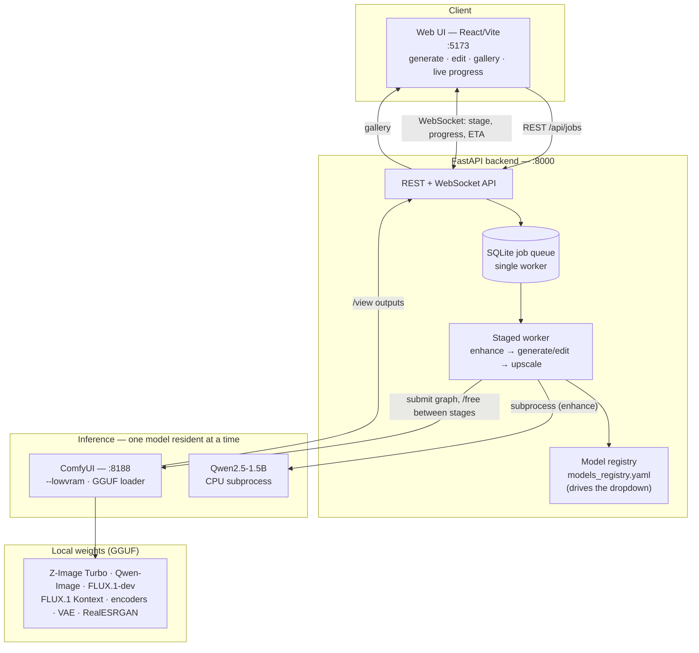
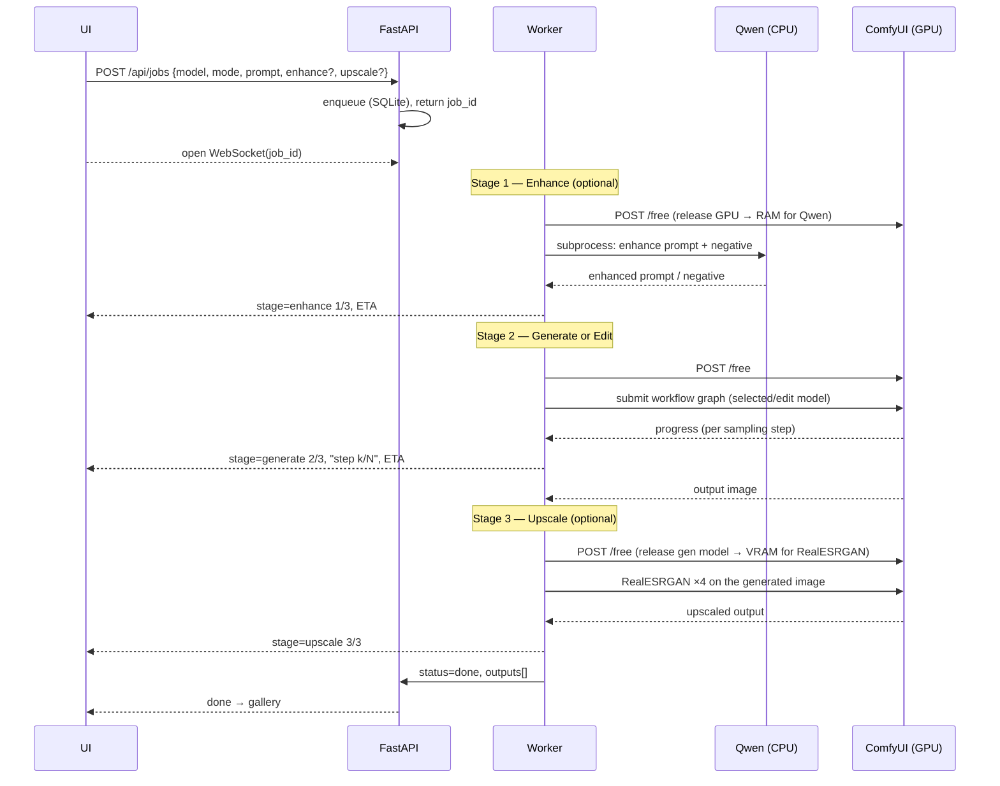
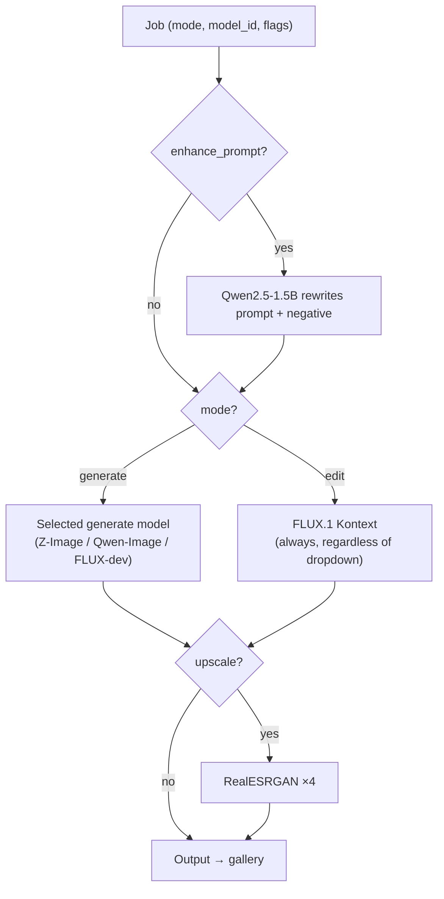
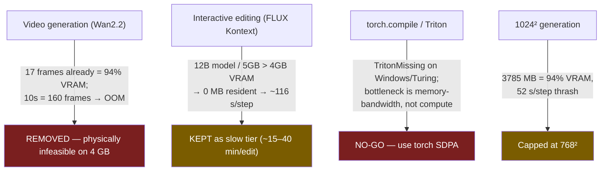
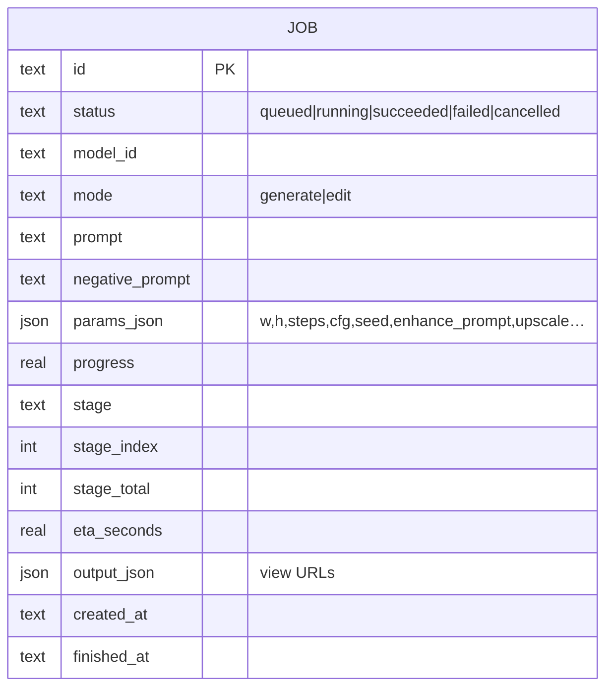

# VizGen — Architecture & Design Decisions

VizGen is a local image-generation and instruction-editing workbench built around a 4 GB development GPU. This document describes the orchestration and memory tradeoffs used on that reference machine.

---

## 1. System Overview

Three processes cooperate: a **web UI**, a **FastAPI orchestration backend** (queue + staged pipeline + model registry), and a **headless ComfyUI engine** that actually runs the diffusion models. A small **CPU-only LLM** handles prompt enhancement out-of-band so it never competes for the GPU.

**Why a FastAPI layer in front of ComfyUI** instead of using ComfyUI directly: the backend provides a persistent queue, model registry, staged jobs, and progress events above the inference engine.

**Why ComfyUI as the engine** instead of raw `diffusers`: it exposes the low-VRAM execution, tiled VAE, GGUF custom-node support, and HTTP/WebSocket interfaces used by these workflows. This is a project design choice, not a comparative engine benchmark.

---

## 2. The Job Lifecycle (staged, load-use-release)

Every request is a sequence of stages. Each stage **loads its model, runs, and releases it before the next stage starts** — the single most important pattern for fitting a multi-model workflow into 4 GB. Stages are optional except the core generate/edit.

Key point: **the enhancer runs as a separate OS process**. When it exits, the OS reclaims its ~6 GB of RAM cleanly — no manual memory management, and it never touches the GPU (it's CPU-only), so the GPU stays free for the diffusion model that follows.

---

## 3. Memory Discipline — the core of the 4 GB design

On a 4 GB card, you cannot hold two models at once. The whole system is organized around **one resident model, explicitly released between stages**.

Mechanisms:
- **`POST /free {unload_models, free_memory}`** to ComfyUI between every stage — verified to drop the GPU back to ~0.5 GB.
- **`--lowvram`** keeps only the actively-executing sub-module on the GPU and streams the rest from CPU RAM (pinned memory) — this is how a 5–7 GB model "runs" on a 4 GB card.
- **GGUF quantization** (Q4/Q5) shrinks the weights on disk and in memory so partial residency is even possible.
- **Single-worker queue**: exactly one job touches the GPU at a time. With one GPU there is no parallelism to exploit, and concurrent jobs would just thrash — the SQLite queue serializes everything.

---

## 4. Task Routing — the model is chosen by the task

The UI exposes *generate* and *edit*. The backend picks the actual model internally, so features compose without the user wiring them together.

The dropdown itself is **100 % registry-driven** (`backend/models_registry.yaml`): each entry declares its `task`, GGUF paths, workflow graph, per-model defaults, and launch flags. Adding a model = adding a registry entry + a workflow JSON; no code change.

---

## 5. Design Decisions & Rationale

### Engine & structure
| Decision | Why (given 4 GB / local / open-weight) | Trade-off accepted |
|---|---|---|
| ComfyUI as the inference engine | Best OSS low-VRAM manager + GGUF loader + headless API; no built-in filter | Extra process to manage |
| FastAPI orchestration layer on top | One product surface: queue, gallery, dropdown, staged pipelines, ETA | More moving parts than "just ComfyUI" |
| Registry-driven model list | Add models via YAML + workflow JSON, no code changes | Registry/workflow must stay in sync |
| Single-worker SQLite queue | One GPU → no parallelism; serialization prevents thrash | No concurrent jobs |

### Memory / 4 GB
| Decision | Why | Trade-off |
|---|---|---|
| GGUF-quantized models everywhere | Only way large DiTs fit in/near 4 GB | Slight quality loss vs fp16 |
| `--lowvram` weight streaming | Runs 5–7 GB models on a 4 GB card via CPU offload | Slower per step |
| `/free` between every stage | Reduce simultaneous model residency; explicit release between stages | Cold reload each stage |
| Enhancer as CPU subprocess | Frees ~6 GB RAM on exit; never competes for GPU | Cold LLM load per job |
| **Q4_K_M over Q3** | Benchmarks show VRAM peak is *activation-bound* — Q3 buys no headroom, Q4 is sharper | Marginally larger file |
| **Cap generate at 768²** | 1024² pushes VRAM to 94 % → per-step weight-streaming (~7 min) | Lower max resolution (upscale ×4 recovers pixels) |
| Prefer few-step "turbo/Lightning" models | Fewer steps ≈ far less wall-clock; models that *fit* avoid per-step thrash | Fewer step-count knobs |

### Models
| Decision | Why |
|---|---|
| **Z-Image Turbo** as default generator | Few-step reference configuration with recorded timings and qualitative output inspection |
| FLUX-dev / Qwen-Image as options | Quality alternatives; kept but flagged (heavier, slower) |
| **FLUX.1 Kontext** for editing | Best open instruction-editor; kept as a **slow tier** (12 B > 4 GB → ~15–40 min/edit) |
| Qwen2.5-1.5B (CPU) enhancer / RealESRGAN upscaler | Cheap, CPU-or-light features that compose in the staged pipeline |

### Deployment
| Decision | Why |
|---|---|
| `setup.bat` (one-time) / `launch.bat` (run) | One-command install + run for a non-dev on Windows |
| Weights/engine/venv **gitignored**, recreated by setup | Keep the repo to code + setup only (~0.5 MB, not tens of GB) |
| `local/` private overlay (gitignored) merged by the registry | Machine-only additions never enter the public product |

---

## 6. What we deliberately rejected (and why)

The recurring physics: **any model or activation set larger than ~4 GB cannot stay resident, so it streams every step** — this killed video, makes 12 B editing a slow tier, and caps resolution. It's also why few-step models that *fit* (Z-Image Turbo) are the sweet spot.

The other recurring cost is the **CPU text-encode** (5–6 GB encoders under 16 GB RAM pressure ≈ minutes) — it dominates cold-start latency far more than GPU sampling. The highest-value future optimization is caching/reusing text embeddings.

---

## 7. Data Model

Jobs live in a single SQLite table; the staged-pipeline UI fields (`stage`, `stage_index`, `stage_total`, `eta_seconds`) were added by migration so the frontend can render the progression.

## 8. Component Map

| Concern | Location |
|---|---|
| REST/WebSocket API, job model | `backend/app/main.py` |
| Staged worker (enhance→generate/edit→upscale) | `backend/app/worker.py` |
| ComfyUI client (`/free`, submit, upscale) | `backend/app/comfy_client.py` |
| Job store + migrations | `backend/app/store.py` |
| Model registry loader | `backend/app/registry.py` |
| Model dropdown / defaults | `backend/models_registry.yaml` |
| ComfyUI workflow graphs | `backend/workflows/` |
| Prompt enhancer (CPU LLM) | `scripts/prompt_enhance.py` |
| Web UI | `frontend/src/` |
| Setup / run | `setup.bat`, `launch.bat` |

See **[BENCHMARKS.md](BENCHMARKS.md)** for the measured numbers behind these decisions and **[plan.md](plan.md)** for the project history.
